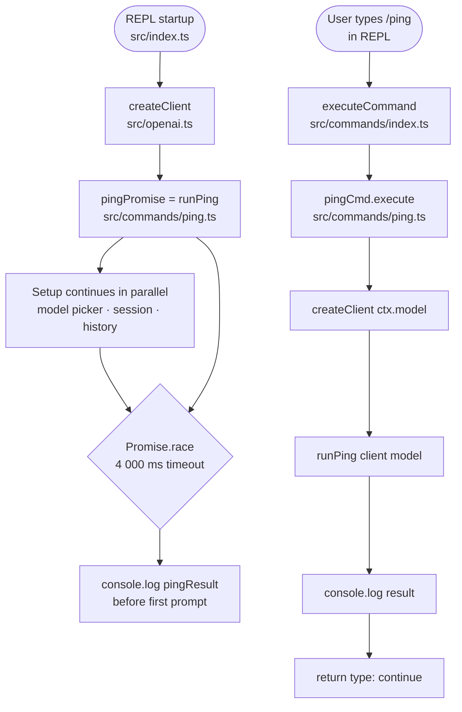

# `/ping` Health Check Command

> Verifies that the configured API endpoint is reachable and the API key is valid by sending a minimal request and reporting round-trip latency — without consuming meaningful tokens or requiring the user to send a real message.

## Table of Contents

- [Overview](#overview)
- [Architecture](#architecture)
  - [Files involved](#files-involved)
  - [Architecture flow diagram](#architecture-flow-diagram)
  - [Data flow](#data-flow)
  - [Key types / interfaces](#key-types--interfaces)
- [Core code breakdown](#core-code-breakdown)
- [Workflow](#workflow)
- [Configuration & flags](#configuration--flags)
- [Edge cases & safety](#edge-cases--safety)
- [Example usage](#example-usage)
- [Related features](#related-features)

---

## Overview

Before `/ping`, there was no way to verify that `API_KEY` and `BASE_URL` were correct without sending a real user message. Misconfigured credentials only surfaced mid-conversation, with an opaque API error and no actionable hint.

`/ping` fixes this by firing a single minimal chat completion (`"Say OK"`, `max_completion_tokens: 5`) against the active model and measuring how long it takes. The same logic runs automatically in the background at startup on the REPL path, so the user knows immediately whether credentials are healthy — before they type their first prompt.

---

## Architecture

### Files involved

| File | Role in this feature |
|---|---|
| `src/commands/ping.ts` | Core logic — `runPing()` helper and the `/ping` `SlashCommand` export |
| `src/commands/index.ts` | Registers `pingCmd` so `/ping` appears in the command router and `/help` |
| `src/index.ts` | Wires the background startup ping: starts it right after `createClient()`, awaits its result with a 4-second timeout just before the first REPL prompt |
| `src/openai.ts` | `createClient()` — builds the `OpenAI` client used by `runPing` |
| `test/ping.test.ts` | Unit tests for `runPing` using a mock client (no live API calls) |

### Architecture flow diagram



### Data flow

**Startup path (background):**

1. `src/index.ts` calls `createClient(model)` to create the OpenAI client.
2. Immediately after, `pingPromise = runPing(client, model)` starts the ping in the background — no `await`, so setup continues without blocking.
3. The setup wizard runs (session init, history load, KB selection).
4. Just before `printSeparator()` and "Agent ready!", `Promise.race([pingPromise, pingTimeout])` resolves whichever settles first — the ping result or the 4-second timeout sentinel.
5. The resolved string is printed with two-space indentation to match the surrounding startup log.

**Slash command path (`/ping`):**

1. User types `/ping` in the REPL.
2. `executeCommand` in `src/commands/index.ts` looks up `pingCmd` and calls `execute(ctx)`.
3. `execute` creates a fresh `OpenAI` client via `createClient(ctx.model)` and calls `runPing(client, ctx.model)`.
4. `runPing` fires a non-streaming `chat.completions.create` call; on return it computes `Date.now() - start`.
5. The result string is printed to `stdout` and `{ type: 'continue' }` is returned so the REPL resumes.

### Key types / interfaces

```typescript
// src/commands/types.ts
export interface SlashCommand {
  name: string;             // "/ping"
  aliases?: string[];       // none
  description: string;      // shown in /help
  usage?: string;
  execute: (ctx: CommandContext, args?: string) => Promise<CommandAction>;
}

export type CommandAction =
  | { type: 'continue' }   // /ping always returns this
  | { type: 'exit' }
  | { type: 'retry' }
  | { type: 'update'; updates: Partial<CommandContext> };
```

`runPing` itself is a plain `async function` — not part of a formal interface — but it is exported so `src/index.ts` can call it directly without importing the full command object:

```typescript
export async function runPing(client: OpenAI, model: string): Promise<string>
```

---

## Core code breakdown

### `runPing` — `src/commands/ping.ts:19-45`

```typescript
export async function runPing(client: OpenAI, model: string): Promise<string> {
  const start = Date.now();
  try {
    await client.chat.completions.create({
      model,
      messages: [{ role: 'user', content: 'Say OK' }],
      max_completion_tokens: 5,
    });
    const latency = Date.now() - start;
    return `✅ API reachable — model: ${model} — latency: ${latency}ms`;
  } catch (err: unknown) {
    const status = (err as { status?: number }).status;
    const message = (err as { message?: string }).message ?? String(err);

    if (status === 401 || status === 403) {
      return `❌ API unreachable — ${status} Unauthorized — check API_KEY in .env`;
    }
    if (status === 404) {
      return `❌ API unreachable — 404 Not Found — check BASE_URL and model name in .env`;
    }
    if (status !== undefined) {
      return `❌ API unreachable — ${status} ${message} — check BASE_URL in .env`;
    }
    // Network-level error (ECONNREFUSED, timeout, etc.)
    return `❌ API unreachable — ${message} — check BASE_URL in .env`;
  }
}
```

| Lines | What it does | Why it matters |
|---|---|---|
| `const start = Date.now()` | Captures wall-clock time before the request | Latency is measured end-to-end including TLS negotiation and queueing — the most useful number for diagnosing a slow endpoint |
| `chat.completions.create(...)` | Non-streaming completion with `max_completion_tokens: 5` and content `"Say OK"` | Non-streaming avoids streaming-chunk overhead; `max_completion_tokens` (not the deprecated `max_tokens`) works with o-series/reasoning models that reject the older parameter; 5 tokens keeps cost near zero |
| `Date.now() - start` on success | Computes round-trip in milliseconds | Gives the user a concrete number to compare across models/endpoints |
| `status === 401 \|\| status === 403` branch | Maps both "wrong key" HTTP codes to the same API_KEY hint | 403 Forbidden can appear on some providers with invalid keys; treating it the same as 401 avoids a confusing "check BASE_URL" hint for an auth problem |
| `status === 404` branch | Suggests checking both `BASE_URL` and the model name | The two most common causes of a 404 from an OpenAI-compatible endpoint — wrong path prefix or non-existent model |
| `status !== undefined` branch | Handles all other HTTP errors with a BASE_URL hint | Catches 400, 429, 500, 502, etc. with their actual message for diagnosability |
| Network catch (no status) | Handles `ECONNREFUSED`, DNS failures, OS-level timeouts | These errors have no HTTP status; the raw message (e.g. `ECONNREFUSED 127.0.0.1:8080`) is the most actionable text |

**What makes this the core:** `runPing` is the only function that actually tests connectivity. The slash command's `execute` and the startup integration both delegate entirely to it — they supply a client and model name, and `runPing` returns the human-readable verdict. Removing it would break both the interactive command and the startup check in one move.

### Startup integration — `src/index.ts` (REPL path)

```typescript
// Immediately after: let client = createClient(model);  [REPL path only]
const pingPromise = runPing(client, model);

// … setup wizard runs (model picker, sessions, history) …

// Just before "Agent ready!" separator:
const pingTimeout = new Promise<string>(resolve =>
  setTimeout(() => resolve('⏱  Ping timed out — check BASE_URL in .env'), 4000)
);
const pingResult = await Promise.race([pingPromise, pingTimeout]);
console.log(`  ${pingResult}`);
```

| Lines | What it does | Why it matters |
|---|---|---|
| `pingPromise = runPing(...)` | Starts the ping immediately, no `await` | The ping runs in parallel with the rest of startup (session init, KB loading) so it costs zero additional startup time in the happy path |
| Placed after single-turn `if (prompt) { ... return; }` | Ensures the ping only fires on the interactive REPL path | Headless/scripted runs (`clic "prompt"`, `--paste`) never fire the ping — no wasted tokens on CI or automation |
| `Promise.race([pingPromise, pingTimeout])` | Resolves whichever settles first | If the API is slow or offline, the 4-second timeout prevents the startup from hanging indefinitely waiting for a response |
| `'⏱  Ping timed out — …'` sentinel | Returns a user-readable timeout message | Distinct from an error — means the endpoint exists but is responding slowly, which is a different operational concern |

---

## Workflow

### Interactive `/ping` command

The user types `/ping` in the REPL at any time. `executeCommand` resolves the name against the command map and calls `pingCmd.execute(ctx)`. A fresh `OpenAI` client is created from the current environment (`API_KEY`, `BASE_URL`) and the active model from `ctx.model`. `runPing` fires a minimal completion request, measures the round trip, and returns the result string. The string is printed and the REPL continues.

### Background startup ping

On interactive startup (REPL mode only), `src/index.ts` starts `runPing` as a non-blocking background Promise right after the OpenAI client is created. The rest of the setup wizard runs concurrently — model selection, session loading, history loading, KB selection. By the time the setup completes and CLIC is ready to show "Agent ready!", the ping has usually already resolved. The `Promise.race` with the 4-second timeout ensures the result is printed before the first user prompt regardless of network conditions.

---

## Configuration & flags

| Setting | Source | Default | Effect |
|---|---|---|---|
| `API_KEY` | `.env` / shell env / `~/.clic/.env` | _(required)_ | Used by `createClient()` as `apiKey`; a missing or wrong key produces a 401/403 result |
| `BASE_URL` | `.env` / shell env / `~/.clic/.env` | `https://api.openai.com/v1` | Used by `createClient()` as `baseURL`; a wrong value produces a 404 or network error |
| Active model | set at startup via picker or `--model` | `DEFAULT_MODEL` from `src/config.ts` | Passed as the `model` parameter to `runPing`; must exist at the endpoint |

There is no flag to disable the startup ping. It fires on every interactive REPL startup and is silent only if the timeout is reached (in which case the timeout message is printed instead).

---

## Edge cases & safety

**Reasoning / o-series models:** These models reject `max_tokens` and require `max_completion_tokens`. `/ping` uses `max_completion_tokens: 5` exclusively to avoid a false "unreachable" error when the user has selected a reasoning model.

**Single-turn and `--paste` mode:** `pingPromise` is assigned inside the REPL path only (after the `if (prompt) { ... return; }` early-return block). Single-turn invocations (`clic "prompt"`) and `--paste` mode never fire the ping.

**Network-level failures (no HTTP status):** `ECONNREFUSED`, DNS resolution failures, and OS-level timeouts throw errors with no `.status` property. The final catch branch uses the raw `Error.message` as the description — this is typically the most actionable text (e.g. `ECONNREFUSED 127.0.0.1:11434`).

**Slow endpoints:** If the API endpoint takes more than 4 seconds to respond, `Promise.race` resolves with the timeout sentinel (`⏱  Ping timed out — check BASE_URL in .env`) rather than waiting indefinitely.

**`runPing` never throws:** Every code path inside `runPing` returns a string — the `try/catch` swallows all errors. This guarantees that the startup `Promise.race` always resolves to a printable string and never causes an unhandled rejection.

**403 vs 401:** Some OpenAI-compatible providers return 403 for an invalid API key rather than 401. Both are mapped to the `check API_KEY in .env` hint.

---

## Example usage

### Interactive command

```
clic> /ping
✅ API reachable — model: gpt-4o — latency: 342ms
```

```
clic> /ping
❌ API unreachable — 401 Unauthorized — check API_KEY in .env
```

```
clic> /ping
❌ API unreachable — 404 Not Found — check BASE_URL and model name in .env
```

```
clic> /ping
❌ API unreachable — ECONNREFUSED 127.0.0.1:11434 — check BASE_URL in .env
```

### Startup background ping (REPL mode)

```
  ✅ Setup complete

  ✅ API reachable — model: gpt-4o — latency: 211ms
  ──────────────────────────────────────────────
  🚀 Agent ready! Type your request. (type '/help' for tips)
  ──────────────────────────────────────────────
```

If credentials are broken the user sees the error immediately, before their first prompt:

```
  ✅ Setup complete

  ❌ API unreachable — 401 Unauthorized — check API_KEY in .env
  ──────────────────────────────────────────────
  🚀 Agent ready! Type your request. (type '/help' for tips)
```

If the endpoint is slow to respond:

```
  ⏱  Ping timed out — check BASE_URL in .env
```

---

## Related features

- **`src/openai.ts` — `createClient()`**: Builds the `OpenAI` client used by `runPing`. The ping result reflects exactly the same `API_KEY` / `BASE_URL` values that all other API calls use.
- **`src/commands/index.ts` — command registry**: Registers `/ping` so it appears in `/help` and is reachable via `executeCommand`.
- **`src/index.ts` — setup wizard**: The startup ping runs after the client is created but before the first prompt, giving the user early feedback without delaying setup.
- **`src/commands/status.ts` — `/status`**: Companion command that shows session, model, and context info. `/ping` focuses on external reachability; `/status` focuses on internal CLIC state.
- **`test/ping.test.ts`**: Unit tests for `runPing` with a mock client — covers success, 401, 404, and network error paths. Run with `pnpm test:ping`.
