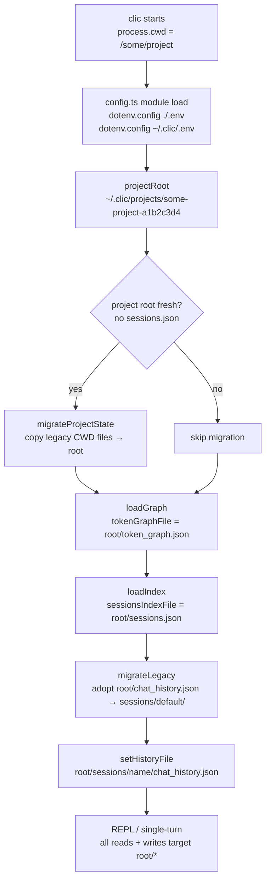

# Project-Scoped Global Storage

> CLIC scopes all its state (chat history, sessions, token graph) per project under a global root (`~/.clic/projects/<basename>-<hash8>/`), so the project folder stays clean and every project gets isolated history — exactly the way `claude` works.

## Table of Contents

- [Overview](#overview)
- [Architecture](#architecture)
  - [Files involved](#files-involved)
  - [Architecture flow diagram](#architecture-flow-diagram)
  - [Data flow](#data-flow)
  - [Key types / interfaces](#key-types--interfaces)
- [Core code breakdown](#core-code-breakdown)
- [Workflow](#workflow)
- [Configuration & flags](#configuration--flags)
- [Edge cases & safety](#edge-cases--safety)
- [Example usage](#example-usage)
- [Related features](#related-features)

---

## Overview

Before this feature, CLIC wrote `chat_history.json`, `sessions/`, `sessions.json`, and `token_graph.json` as relative paths — landing them directly in whatever directory it was run from. This polluted project folders and made global installation impractical because credentials also needed a `.env` in every directory.

The fix mirrors what Claude Code (`claude`) does: all state moves under `~/.clic/projects/`, keyed by the project's canonical absolute path. Two folders with the same name in different locations always get separate state (collision-safe via SHA-256 hash). A global `~/.clic/.env` credential fallback means API keys can be configured once for all projects.

This makes `clic` a true globally-installable CLI: `npm install -g clic` once, then `clic` in any project folder just works.

---

## Architecture

### Files involved

| File | Role in this feature |
|---|---|
| `src/config.ts` | Central path resolution: `clicHome()`, `projectDirName()`, `projectRoot()`, and the five storage resolvers. Also owns the ordered dotenv credential loading. |
| `src/session.ts` | `migrateProjectState()` — one-time lossless relocation of legacy CWD state into the fresh project root. Also `migrateLegacy()` — unchanged logic, now operating inside `projectRoot()`. |
| `src/memory.ts` | `activeHistoryFile` is lazy (null default) so importing the module never snapshots `process.cwd()` at load time. `getHistoryFile()` resolves via `historyFile()` on first use. |
| `src/index.ts` | Startup wiring: calls `migrateProjectState()` → `loadGraph(tokenGraphFile())` → `migrateLegacy()` → `setHistoryFile(sessionHistoryPath(name))` in the correct order. |
| `src/privacy.ts` | `isEphemeral()` — gates both `migrateProjectState()` and all save paths; ephemeral runs never write to the project root. |
| `test/project-storage.test.ts` | 27-test suite covering all guarantees: naming stability, collision safety, sanitization, `CLIC_HOME` override, `AGENT_*` overrides, migration idempotency, ephemeral no-op, credential precedence. |

### Architecture flow diagram



### Data flow

1. **Module load** — `src/config.ts` runs two `dotenv.config()` calls (project `.env` then `~/.clic/.env`) before any other code in the file executes. Shell env vars already set are never overwritten.
2. **`projectRoot()` resolved** — any call to `historyFile()`, `tokenGraphFile()`, `sessionsDir()`, or `sessionsIndexFile()` calls `projectRoot()` → `projectDirName()` → `realpathSync(cwd)` + SHA-256 hash.
3. **`migrateProjectState()`** — called at startup. Checks for `sessions.json` in the project root; if absent, copies `chat_history.json`, `token_graph.json`, `sessions.json`, and `sessions/` from CWD into the root (lossless — originals stay).
4. **`loadGraph(tokenGraphFile())`** — reads the token Knowledge Graph from the project-scoped path.
5. **`loadIndex()`** — reads `sessions.json` from the project root.
6. **`migrateLegacy()`** — if the session index is empty, adopts `root/chat_history.json` into `root/sessions/default/chat_history.json`.
7. **`setHistoryFile(sessionHistoryPath(name))`** — points memory.ts at `root/sessions/<active>/chat_history.json`.
8. **Every turn** — `saveHistory()`, `saveGraph()`, `saveIndex()` all resolve their paths through the same resolvers → all writes land in `root/`.

### Key types / interfaces

```typescript
// src/config.ts

// Global root — overridable for tests or power users
export function clicHome(): string          // CLIC_HOME || ~/.clic

// Per-project directory name: "<sanitized-basename>-<hash8>"
export function projectDirName(cwd?: string): string

// Absolute project root: clicHome()/projects/projectDirName()
export function projectRoot(cwd?: string): string

// Storage path resolvers (each honors its AGENT_* override verbatim)
export function historyFile(): string        // AGENT_HISTORY_FILE || root/chat_history.json
export function tokenGraphFile(): string     // AGENT_TOKEN_GRAPH_FILE || root/token_graph.json
export function sessionsDir(): string        // AGENT_SESSIONS_DIR || root/sessions
export function sessionsIndexFile(): string  // AGENT_SESSIONS_INDEX_FILE || root/sessions.json
export function sessionHistoryPath(name: string): string  // sessionsDir()/name/chat_history.json
```

```typescript
// src/session.ts

// One-time relocation of legacy CWD state
export async function migrateProjectState(cwd?: string): Promise<void>
```

---

## Core code breakdown

### `projectDirName` — `src/config.ts:45-54`

```typescript
export function projectDirName(cwd: string = process.cwd()): string {
  let canonical: string;
  try {
    canonical = realpathSync(cwd);
  } catch {
    canonical = path.resolve(cwd); // dir deleted/unreadable — defensive, never crash
  }
  const hash8 = crypto.createHash('sha256').update(canonical).digest('hex').slice(0, 8);
  return `${sanitizeBasename(path.basename(canonical))}-${hash8}`;
}
```

| Lines | What it does | Why it matters |
|---|---|---|
| 47–51 | Calls `realpathSync(cwd)` to resolve symlinks and normalise trailing slashes; falls back to `path.resolve` if the directory is unreadable | Ensures the same physical directory always maps to the same project root, regardless of how it was referenced |
| 52 | Computes `sha256(canonicalPath).slice(0,8)` | The hash covers the **full** canonical path — two folders with the same basename in different locations get different hashes, guaranteeing no collision |
| 53 | Concatenates `sanitizeBasename(path.basename(canonical))` + `-` + `hash8` | Produces a short, human-readable, filesystem-safe name like `my-app-a1b2c3d4` |

**What makes this the core:** Every storage path resolver calls `projectRoot()` which calls `projectDirName()`. Remove or break this function and all state for every project lands in the same directory, destroying isolation. The SHA-256 of the canonical path is the single source of truth for which project a CLIC instance belongs to.

---

### `migrateProjectState` — `src/session.ts:239-281`

```typescript
export async function migrateProjectState(cwd: string = process.cwd()): Promise<void> {
  if (isEphemeral()) return;

  const root = projectRoot(cwd);

  try {
    await fs.access(path.join(root, 'sessions.json'));
    return; // already migrated
  } catch { /* root is fresh — proceed */ }

  const entries = ['chat_history.json', 'token_graph.json', 'sessions.json', 'sessions'];
  let copied = false;
  for (const entry of entries) {
    const src = path.join(cwd, entry);
    const dst = path.join(root, entry);
    try { await fs.access(src); } catch { continue; }   // skip if not in CWD
    try { await fs.access(dst); continue; } catch {}    // skip if already in root
    try {
      await fs.mkdir(root, { recursive: true });
      await fs.cp(src, dst, { recursive: true });
      copied = true;
    } catch { /* best-effort */ }
  }
  if (copied) console.log(`  📦 Migrated existing CLIC state into ${root}`);
}
```

| Lines | What it does | Why it matters |
|---|---|---|
| `if (isEphemeral()) return` | Skips migration in `--no-history` mode | Ephemeral runs must never write to disk |
| `fs.access(root/sessions.json)` | Fresh-root guard — returns early if root already has a session index | Idempotency: migration runs exactly once per project root |
| `entries` array | Defines the four items to copy | Covers complete prior state: history, token graph, index, and session subdirectory |
| Per-entry `fs.access(src)` | Skips entries not present in CWD | Silent no-op for fresh global installs |
| Per-entry `fs.access(dst)` | Skips entries already in root | Safe resume if a prior migration was partially interrupted |
| `fs.cp(src, dst, { recursive: true })` | Copies (never moves) the entry | Lossless — originals in CWD remain untouched |

**What makes this the core:** Without this function, upgrading from an older CLIC install would silently lose all prior chat history and session state. It bridges the old (CWD-relative) and new (globally-scoped) storage models, and its idempotency guarantee means it can safely run on every startup.

---

## Workflow

### Normal startup (existing project, state already migrated)

1. `src/config.ts` loads — `dotenv.config()` reads `./.env`; second call reads `~/.clic/.env` for any vars not yet set.
2. `migrateProjectState()` runs — finds `sessions.json` already in `projectRoot()`, returns immediately (no-op).
3. `loadGraph(tokenGraphFile())` reads the Knowledge Graph from `~/.clic/projects/<dir>/token_graph.json`.
4. `loadIndex()` reads the session index from `~/.clic/projects/<dir>/sessions.json`.
5. `migrateLegacy()` runs — index already has sessions, returns immediately.
6. `setHistoryFile(sessionHistoryPath(sessionName))` points memory.ts at `~/.clic/projects/<dir>/sessions/<name>/chat_history.json`.
7. Every agent turn saves history, graph, and index back to the same `~/.clic/projects/<dir>/` root.

### First run (legacy CWD state exists)

Same as above, except at step 2: `migrateProjectState()` finds no `sessions.json` in the root, copies all four legacy entries from CWD into the root, and prints `📦 Migrated existing CLIC state into ~/.clic/projects/<dir>/`. Originals in CWD are not deleted.

### First run (fresh global install, no prior state)

`migrateProjectState()` finds no legacy files in CWD — the loop completes without copying anything. `migrateLegacy()` creates a fresh `sessions/default/` and seeds an empty `sessions.json`.

---

## Configuration & flags

| Variable / flag | Effect | Default | Source |
|---|---|---|---|
| `CLIC_HOME` | Overrides the global root directory | `~/.clic` | `src/config.ts:clicHome()` |
| `AGENT_HISTORY_FILE` | Overrides `historyFile()` verbatim, bypassing `projectRoot()` | _(unset)_ | `src/config.ts:historyFile()` |
| `AGENT_TOKEN_GRAPH_FILE` | Overrides `tokenGraphFile()` verbatim | _(unset)_ | `src/config.ts:tokenGraphFile()` |
| `AGENT_SESSIONS_DIR` | Overrides `sessionsDir()` verbatim | _(unset)_ | `src/config.ts:sessionsDir()` |
| `AGENT_SESSIONS_INDEX_FILE` | Overrides `sessionsIndexFile()` verbatim | _(unset)_ | `src/config.ts:sessionsIndexFile()` |
| `API_KEY` | Required LLM credential. Loaded shell env → `./.env` → `~/.clic/.env` | _(none)_ | `src/config.ts` dotenv ordered load |
| `BASE_URL` | OpenAI-compatible endpoint. Same precedence as `API_KEY`. | `https://api.openai.com/v1` | `src/config.ts` dotenv ordered load |
| `--no-history` | Ephemeral mode — `migrateProjectState()` is a no-op, all writes skipped | _(off)_ | `src/privacy.ts:isEphemeral()` |

**Credential precedence (first wins):**
```
shell env  >  ./.env (project-local)  >  ~/.clic/.env (global fallback)
```

---

## Edge cases & safety

| Scenario | Handling |
|---|---|
| `realpathSync(cwd)` throws (directory deleted mid-run) | Falls back to `path.resolve(cwd)` — `projectDirName()` never throws |
| `~/.clic/` not writable | `saveHistory`, `saveGraph`, `saveIndex` all `try/catch` silently — reads still work |
| `CLIC_HOME` set to a temp dir | Entire root relocates; used by the test suite to isolate from real `~/.clic/` |
| `AGENT_*` override set | That exact path is used verbatim, bypassing `projectRoot()` — backward-compatible with test fixtures |
| Ephemeral mode (`--no-history`) | `migrateProjectState()` returns immediately; all `save*` functions also skip via `isEphemeral()` |
| Two projects with the same folder name | Different canonical paths → different `hash8` → different `projectRoot()` → no collision |
| Symlink vs real path to same directory | `realpathSync()` resolves both to same canonical path → same `projectRoot()` → no duplicate state |
| Migration already ran | `sessions.json` present in root → `migrateProjectState()` returns in O(1) |
| Partial migration interrupted | Per-entry destination-exists check skips already-copied entries — safe to resume |

---

## Example usage

### Global install — first run in a new project

```bash
# Install once globally
npm install -g .

# Go to any project
cd ~/work/my-api

# Run clic — state scoped to ~/.clic/projects/my-api-7f3a9c21/
clic "summarise the README"

# Each project gets its own isolated directory
ls ~/.clic/projects/
# my-api-7f3a9c21/
# CLIC-Agentic-CLI-like-Code-Claude-40d14ddd/
```

### Global credentials via `~/.clic/.env`

```bash
# Set once — works from every project folder
mkdir -p ~/.clic
echo 'API_KEY=sk-...'                          >> ~/.clic/.env
echo 'BASE_URL=https://api.openai.com/v1'      >> ~/.clic/.env

# No .env needed in individual projects
cd ~/any-project
clic "hello"   # picks up credentials from ~/.clic/.env
```

### Overriding the global root (CI / testing)

```bash
CLIC_HOME=/tmp/clic-ci clic --no-history "run smoke test"
# State lands in /tmp/clic-ci/projects/<dir>/ — never touches ~/.clic/
```

### Confirming project isolation

```bash
cd ~/project-a && clic "/session"   # shows project-a's sessions only
cd ~/project-b && clic "/session"   # completely separate session list
```

---

## Related features

- **Named Sessions** (`src/session.ts`, `src/commands/session.ts`) — sessions are subdirectories inside `projectRoot()/sessions/`; the entire session lifecycle operates within the per-project root.
- **Token Knowledge Graph** (`src/knowledgeGraph.ts`) — `token_graph.json` is stored at `tokenGraphFile()` inside `projectRoot()`; per-project token spend is automatically isolated.
- **Privacy / `--no-history`** (`src/privacy.ts`) — `isEphemeral()` is checked by `migrateProjectState()` and all `save*` functions; ephemeral runs are completely isolated from the project root on disk.
- **Workspace File Watcher** (`src/watcher.ts`) — watches the project CWD for file changes; complements project scoping by tracking external edits per project.
- **Setup Wizard** (`src/index.ts`) — currently prompts for `API_KEY` in-session only (sets `process.env`, not persisted); a future improvement will write to `~/.clic/.env` on first run (tracked as a separate issue).

---

## Design notes & future considerations

### Credential file format — `.env` vs `settings.json`

CLIC deliberately uses `.env` (via `dotenv`) rather than a `settings.json`. This was an explicit decision:

- `.env` is the Node.js CLI convention — `dotenv` is a zero-config standard and the loading order (shell env → `./.env` → `~/.clic/.env`) is immediately familiar to any Node.js developer.
- Switching to JSON would require a custom parser, break existing setups, and add complexity with no real gain in capability.

**This choice is stable.** Don't migrate to `settings.json` as a drive-by refactor — if reconsidered, it should be a dedicated issue with a migration path for existing users.

> **Future issue (tracked separately):** Converting `.env` to `settings.json` for improved usability — e.g., structured config, comments, editor tooling support — is a valid improvement but out of scope for this PR.

### Future issue: Setup wizard should persist credentials to `~/.clic/.env`

The setup wizard currently prompts for `API_KEY` and `BASE_URL` on first run but only writes them to `process.env` for the current session. On the next run it asks again.

The intended improvement is:

```
clic (first run, no API key found in env or any .env)
  → prompts for API_KEY and BASE_URL
  → saves to ~/.clic/.env          ← global, works from every folder forever
  → never prompts again
```

Scope for the separate issue:
- Where to save — global `~/.clic/.env` vs local `./.env`, or offer a choice
- Whether to ask the user which location to save to
- What to do if `~/.clic/.env` already exists (append vs merge vs skip)

This is intentionally not part of the project-scoped storage PR — it is a distinct UX feature with its own edge cases and should be tracked separately.
