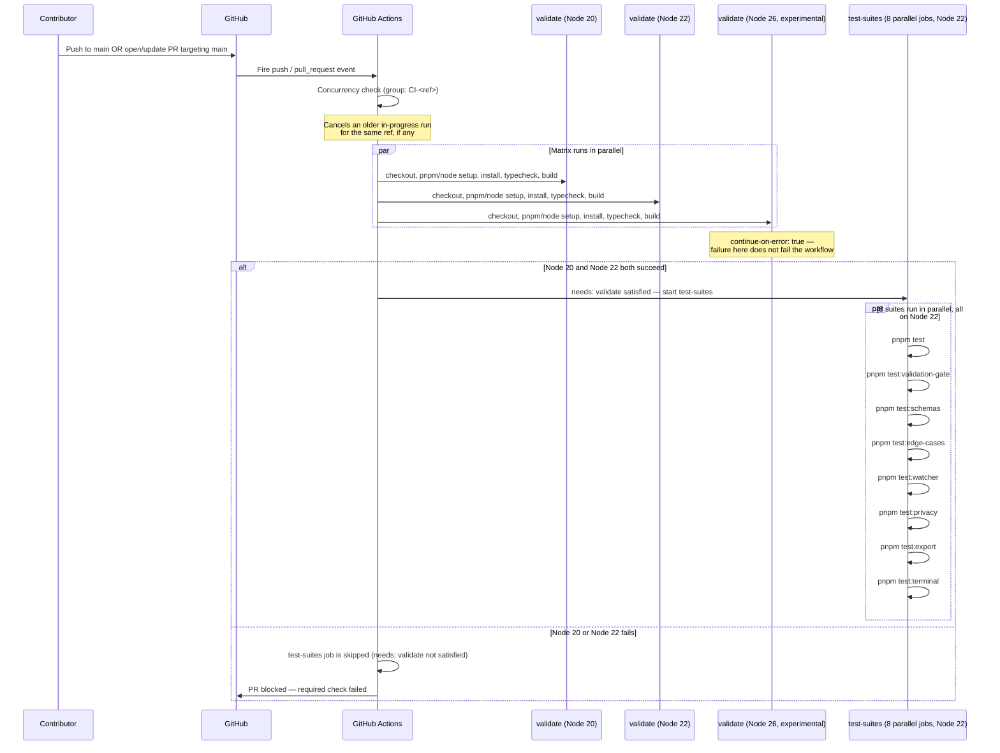
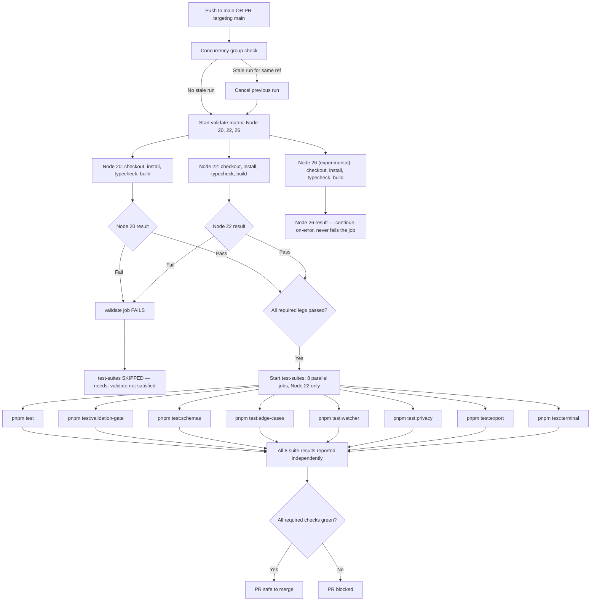

# CI — Continuous Integration Pipeline

> The CI workflow validates every push and pull request to `main` across multiple Node.js versions (typecheck + build), then runs CLIC's full test suite in parallel — the primary quality gate before any code reaches the trunk.

## Table of Contents

- [Overview](#overview)
- [How it works](#how-it-works)
- [Full lifecycle — step by step](#full-lifecycle--step-by-step)
- [Workflow: ci.yml](#workflow-ciyml)
  - [Triggers](#triggers)
  - [Concurrency](#concurrency)
  - [Permissions](#permissions)
  - [Job: validate](#job-validate)
  - [Job: test-suites](#job-test-suites)
- [Why tests only run on Node 22](#why-tests-only-run-on-node-22)
- [Flow diagram](#flow-diagram)
- [Where results show up](#where-results-show-up)
- [Configuration reference](#configuration-reference)
- [Edge cases & safety](#edge-cases--safety)
- [What CI is NOT](#what-ci-is-not)
- [Recommended practices for CLIC](#recommended-practices-for-clic)
- [Future enhancements](#future-enhancements)

---

## Overview

Without this workflow, broken code — type errors, failed builds, regressed test behavior — could only be caught by manually running `pnpm typecheck`/`pnpm build`/`pnpm test` locally, which is easy to skip under time pressure. The CI workflow automates this validation on every push and PR to `main`, giving a visible pass/fail signal before merge.

| Without CI | With CI |
|---|---|
| Type errors/build breakage only caught if someone runs it locally | Every push/PR automatically typechecks + builds on 3 Node versions |
| A single flaky or broken test can silently regress the whole suite | 8 test suites run as independent parallel jobs with isolated pass/fail signal |
| No guarantee a merged PR actually compiles for all supported Node versions | `validate` job proves compilation success across Node 20/22/26 |

---

## How it works

The workflow is split into **two sequential jobs**, each with its own matrix strategy:

```
validate          (matrix: Node 20, 22, 26)
    │
    ├── checkout → pnpm setup → Node setup → install (frozen lockfile)
    ├── pnpm typecheck   (tsc --noEmit)
    └── pnpm build       (tsup)
    │
    ▼  (only runs if validate succeeds — needs: validate)
test-suites        (matrix: 8 test suites, fixed on Node 22)
    │
    ├── checkout → pnpm setup → Node 22 setup → install (frozen lockfile)
    └── pnpm <suite>     (test, test:validation-gate, test:schemas, ...)
```

`validate` proves the code **compiles correctly** across every Node version CLIC claims to support. `test-suites` proves CLIC's **business logic behaves correctly**, but only needs to run once (on a single representative Node version) since the logic itself doesn't change based on which Node runtime executes it — see [Why tests only run on Node 22](#why-tests-only-run-on-node-22).

---

## Full lifecycle — step by step



---

## Workflow: ci.yml

### Triggers

```yaml
on:
  push:
    branches: [main]
  pull_request:
    branches: [main]
```

Fires on direct pushes to `main` and on every PR (open/update/reopen) targeting `main`. It does **not** run on feature-branch pushes without an open PR — CI is enforced at the merge gate, not during exploratory local work.

### Concurrency

```yaml
concurrency:
  group: ${{ github.workflow }}-${{ github.ref }}
  cancel-in-progress: true
```

Groups runs by workflow name + branch/PR ref. A new push to the same PR cancels the previous in-progress CI run for that ref — avoids wasted runner minutes validating an already-superseded commit.

### Permissions

```yaml
permissions:
  contents: read
```

The most minimal permission set of any workflow in this repo — CI only needs to read the repository to check it out, build it, and test it. It never writes labels, comments, releases, or merges anything itself.

### Job: validate

```yaml
validate:
  runs-on: ubuntu-latest
  timeout-minutes: 15

  strategy:
    fail-fast: false
    matrix:
      node-version: [20, 22, 26]
      include:
        - node-version: 26
          experimental: true

  continue-on-error: ${{ matrix.experimental == true }}
```

| Setting | Value | Reason |
|---|---|---|
| `fail-fast: false` | All three Node versions always run to completion, even if one fails | Full cross-version signal instead of stopping early |
| Node 20 | Hard gate | Older LTS — failure blocks the PR |
| Node 22 | Hard gate | Primary/representative LTS target — failure blocks the PR |
| Node 26 | Soft gate (`continue-on-error: true`) | New release — `node-pty` native prebuilds may not exist yet; failure is informational only |

**Steps:** checkout (`actions/checkout@v4`) → pnpm v10 setup (`pnpm/action-setup@v4`) → Node.js setup per matrix version with pnpm caching (`actions/setup-node@v4`) → `pnpm install --frozen-lockfile` (fails fast on lockfile drift) → `pnpm typecheck` (`tsc --noEmit`) → `pnpm build` (`tsup`).

This job **does not run any test suites** — that responsibility belongs entirely to `test-suites`.

### Job: test-suites

```yaml
test-suites:
  runs-on: ubuntu-latest
  timeout-minutes: 15
  needs: validate

  strategy:
    fail-fast: false
    matrix:
      suite:
        - test
        - test:validation-gate
        - test:schemas
        - test:edge-cases
        - test:watcher
        - test:privacy
        - test:export
        - test:terminal
```

| Setting | Value | Reason |
|---|---|---|
| `needs: validate` | Job dependency | Won't start until `validate` completes — no point running tests against code that doesn't even typecheck/build |
| `fail-fast: false` | All 8 suites always run to completion | One failing suite doesn't hide failures in the other 7 — each gets its own isolated pass/fail signal |
| Node version | Fixed at `22` (no matrix) | See [Why tests only run on Node 22](#why-tests-only-run-on-node-22) |

**Steps:** checkout → pnpm v10 setup → Node 22 setup with pnpm caching → `pnpm install --frozen-lockfile` → `pnpm ${{ matrix.suite }}` (dynamically runs whichever `package.json` script the matrix entry names).

Because `needs: validate` only requires the job to complete (not every matrix leg to succeed individually by default on GitHub Actions' job-dependency semantics — a job with `fail-fast: false` that has at least one non-`continue-on-error` matrix leg fail will still mark the job as failed), a genuine Node 20 or Node 22 `validate` failure prevents `test-suites` from running at all. A Node 26-only failure does **not** block it, since that leg is `continue-on-error: true` and doesn't fail the job overall.

---

## Why tests only run on Node 22

This is a deliberate design choice, not an oversight:

1. **Combinatorial cost** — matrixing `test-suites` across all 3 Node versions would mean `3 × 8 = 24` parallel jobs instead of 8, tripling runner-minute cost on every push/PR for comparatively little extra signal.
2. **`validate` already catches Node-version-specific breakage** — `tsc --noEmit` and `tsup` are what actually surface issues that differ *between* Node versions (removed/changed Node APIs, `@types/node` drift, `node-pty` native prebuild/compile differences). CLIC's own business logic (Zod validation, tool schemas, watcher helpers, terminal behavior) doesn't change behavior based on which Node runtime executes it, as long as it compiles successfully on that version.
3. **Node 22 is the representative target** — treated as the stable, primary LTS version (also the version `release.yml` hardcoded for publishing, before that workflow was removed pending CLIC's readiness to ship).
4. **Cost/benefit** — the test suites are the most expensive part of CI (`terminal.test.ts` spins up real PTY shells via `node-pty`); running them 3x for marginal additional confidence isn't considered worth the slower feedback loop.

In short: **"does this compile?" is checked on every supported Node version; "does this work correctly?" is checked once, on the representative version.**

---

## Flow diagram



---

## Where results show up

| Location | What appears |
|---|---|
| PR "Checks" tab | 11 separate check entries — 3 from `validate` (Node 20/22/26) + 8 from `test-suites` (one per suite) |
| Commit status on `main` | Pass/fail badge reflecting the same checks |
| Action logs (`Actions` tab → `CI` run) | Full logs per matrix leg — exact `tsc`/`tsup`/test output for debugging failures |
| Branch protection (if configured) | Required checks must pass before merge is allowed |

A failing Node 26 leg shows as a visibly different status (⚠️ informational, due to `continue-on-error`) rather than a hard ❌, distinguishing it from a genuine blocking failure.

---

## Configuration reference

| Setting | Value | Source |
|---|---|---|
| Trigger events | `push` (main), `pull_request` (targeting main) | `ci.yml` `on` |
| Permissions | `contents: read` only | `ci.yml` `permissions` |
| `validate` Node versions | `20`, `22`, `26` | `ci.yml` `jobs.validate.strategy.matrix.node-version` |
| `validate` fail-fast | `false` | `ci.yml` `jobs.validate.strategy.fail-fast` |
| Node 26 blocking? | No (`continue-on-error: true`) | `ci.yml` `jobs.validate.continue-on-error` |
| `test-suites` dependency | `needs: validate` | `ci.yml` `jobs.test-suites.needs` |
| `test-suites` Node version | `22` only (no matrix) | `ci.yml` `jobs.test-suites` step |
| `test-suites` fail-fast | `false` | `ci.yml` `jobs.test-suites.strategy.fail-fast` |
| Number of test suites | 8 | `ci.yml` `jobs.test-suites.strategy.matrix.suite` |
| Job timeout (both jobs) | 15 minutes | `ci.yml` `timeout-minutes` |
| Lockfile mode | Frozen (`--frozen-lockfile`) | Both jobs' install step |
| pnpm version | `10` | Both jobs' `pnpm/action-setup@v4` step |

---

## Edge cases & safety

**Node 26 failures never block a PR**
`continue-on-error: true` on the Node 26 matrix leg means that even a hard failure (compile error, native module build failure) shows as a warning, not a red ❌. This is intentional — Node 26 is new enough that `node-pty` prebuilds may not yet exist, forcing a slower/less reliable source compile via `node-gyp`.

**`test-suites` is skipped, not failed, if `validate` fails**
Because of `needs: validate`, a Node 20 or Node 22 failure in `validate` prevents `test-suites` from running at all — it shows as "skipped" rather than attempting to test code that doesn't even build. This avoids wasting runner minutes on tests that would almost certainly fail or produce misleading results against broken code.

**Lockfile drift fails fast**
`pnpm install --frozen-lockfile` immediately errors if `pnpm-lock.yaml` is out of sync with `package.json`, surfacing dependency mismatches at the CI gate rather than letting them reach `main` silently.

**`node-pty` and `terminal.test.ts`**
The `test:terminal` suite opens real PTY shells. If a shell hangs waiting for input, the job would run indefinitely without a bound — `timeout-minutes: 15` at the job level forcibly kills a runaway run, freeing the queue.

**Concurrency and force-pushes**
A force-push keeps `github.ref` unchanged, so the newer CI run correctly cancels the stale one rather than both running to completion and potentially reporting misleading results against an outdated commit.

**8 independent test-suite jobs mean 8 independent `pnpm install` steps**
Each matrix leg in `test-suites` re-runs its own checkout + pnpm setup + install, rather than sharing a single install across all 8 suites. This is slightly redundant but keeps each suite's job fully isolated and independently re-runnable/debuggable; pnpm's cache (`cache: pnpm` in `setup-node`) mitigates most of the redundant cost.

---

## What CI is NOT

- It is **not** a security scanner — see [codeql.md](codeql.md) for that
- It does **not** label PRs — see [pr-labeler.md](pr-labeler.md)
- It does **not** publish anything — the former `release.yml` (removed, to be re-added when CLIC is ready to ship) handled that, gated separately on version tags
- It does **not** merge anything automatically — see [dependabot-auto-merge.md](dependabot-auto-merge.md) for the only auto-merge behavior in this repo
- It does **not** test business logic across multiple Node versions — only compilation (typecheck/build) is matrixed; tests run once, on Node 22

---

## Recommended practices for CLIC

| Scenario | Recommended action |
|---|---|
| Adding a new test suite script to `package.json` | Add its name to `jobs.test-suites.strategy.matrix.suite` in `ci.yml` so it runs in CI |
| A Node 26 leg fails due to a missing `node-pty` prebuild | Expected and non-blocking — safe to ignore until Node 26 prebuilds exist upstream |
| Wanting faster feedback during active development | Consider temporarily dropping the Node 26 leg (see prior discussion on CI overhead during active development) |
| A specific test suite is flaky | Isolate and fix it directly — `fail-fast: false` means its failure won't mask results from the other 7 suites |

---

## Future enhancements

| Enhancement | When to add |
|---|---|
| Re-add Node-version matrix to `test-suites` | Once CLIC has a broader user base actually running varied Node versions in production |
| Branch protection requiring all 11 checks | Once the team wants CI to be a hard, enforced merge gate rather than advisory |
| Coverage reporting (e.g. `c8`/`istanbul`) | Once test coverage visibility becomes a priority |
| Cache `dist/` between `validate` and `test-suites` | To avoid rebuilding/reinstalling redundantly between the two jobs, if CI time becomes a bottleneck |
