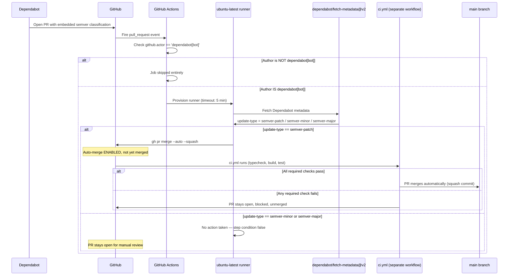
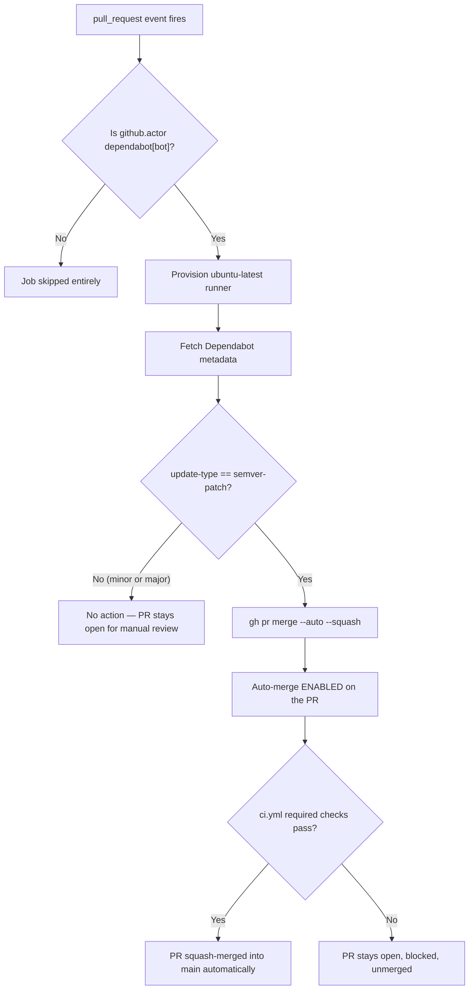

# Dependabot Auto-merge — Automated Patch-Bump Merging

> This workflow automatically enables GitHub's auto-merge on Dependabot pull requests that are pure **patch** version bumps (e.g. `6.37.0 → 6.37.1`) — merging them into `main` once CI passes, with zero manual action required. Minor and major bumps are left untouched for human review.

## Table of Contents

- [Overview](#overview)
- [How it works](#how-it-works)
- [Full lifecycle — step by step](#full-lifecycle--step-by-step)
- [Workflow: dependabot-auto-merge.yml](#workflow-dependabot-auto-mergeyml)
  - [Triggers](#triggers)
  - [Job-level guard](#job-level-guard)
  - [Permissions](#permissions)
  - [Job configuration](#job-configuration)
  - [Steps breakdown](#steps-breakdown)
- [Semver classification reference](#semver-classification-reference)
- [Flow diagram](#flow-diagram)
- [Where results show up](#where-results-show-up)
- [Configuration reference](#configuration-reference)
- [Edge cases & safety](#edge-cases--safety)
- [What Dependabot Auto-merge is NOT](#what-dependabot-auto-merge-is-not)
- [Recommended practices for CLIC](#recommended-practices-for-clic)
- [Future enhancements](#future-enhancements)

---

## Overview

Without this workflow, every Dependabot PR — no matter how trivial — sits open until a maintainer manually clicks "merge," even for the safest category of update (a pure bug-fix patch release). This workflow closes that gap for the lowest-risk case only: pure semver-patch bumps. It never merges anything on its own authority — it only *enables* GitHub's built-in auto-merge feature, which still requires your existing CI pipeline (`ci.yml`) to pass before the merge actually completes.

| Without Auto-merge | With Auto-merge |
|---|---|
| Every Dependabot PR, including trivial patch bumps, needs a manual merge click | Patch bumps merge themselves once CI is green |
| Minor/major bumps and patch bumps get the same manual-review treatment | Only the safest category (patch) is automated; minor/major still require review |
| Maintainer backlog grows with low-risk, repetitive merge chores | Maintainer only reviews what actually needs judgment (minor/major bumps) |

---

## How it works

This workflow has **no companion config file** — everything is defined inline. It relies on two external pieces working together:

```
1. Dependabot itself (GitHub's platform service, not a workflow)
   classifies every version bump it proposes as:
       version-update:semver-patch
       version-update:semver-minor
       version-update:semver-major
   and embeds this classification into the PR it opens.

2. dependabot/fetch-metadata@v2 (an action, run as a step in this workflow)
   reads that embedded classification and exposes it as
   steps.metadata.outputs.update-type

3. This workflow's own `if` condition
   compares that output against 'version-update:semver-patch'
   → true  → enables auto-merge via `gh pr merge --auto --squash`
   → false → does nothing, PR stays open for manual review
```

Crucially, **this workflow does not decide what counts as "patch"** — it only consumes a classification that Dependabot already computed using standard semver rules before the PR was even opened.

---

## Full lifecycle — step by step



---

## Workflow: dependabot-auto-merge.yml

### Triggers

```yaml
on: pull_request
```

Fires on the default `pull_request` event types (`opened`, `synchronize`, `reopened`, etc.) for **every** PR in the repo — not just Dependabot's. The actual filtering down to Dependabot-only happens via the job-level `if` guard below, not the trigger itself.

### Job-level guard

```yaml
jobs:
  auto-merge:
    if: github.actor == 'dependabot[bot]'
```

This is the real gate. Even though the workflow triggers on every PR, the job itself only executes when the PR's author is literally the `dependabot[bot]` GitHub account. Human-opened PRs cause the workflow to fire but the job is skipped immediately — no steps run, no API calls made.

### Permissions

```yaml
permissions:
  pull-requests: write
  contents: write
```

| Permission | Why it's needed |
|---|---|
| `pull-requests: write` | Required to enable auto-merge on the PR via the GitHub CLI |
| `contents: write` | Required to actually perform the squash-merge commit into `main` once checks pass |

### Job configuration

```yaml
jobs:
  auto-merge:
    runs-on: ubuntu-latest
    timeout-minutes: 5
```

Single job named `auto-merge`, runs on `ubuntu-latest`, capped at 5 minutes — this job only makes a couple of API calls, it never builds or tests anything itself (that's `ci.yml`'s job, running as a separate, parallel workflow on the same PR).

### Steps breakdown

```yaml
- name: Fetch Dependabot metadata
  uses: dependabot/fetch-metadata@v2
  id: metadata
```
Runs Dependabot's own official metadata-extraction action against the current PR. Exposes outputs including `update-type`, `dependency-names`, `package-ecosystem`, etc. — this workflow only uses `update-type`.

```yaml
- name: Auto-merge patch bumps
  if: steps.metadata.outputs.update-type == 'version-update:semver-patch'
  run: gh pr merge --auto --squash "$PR_URL"
  env:
    PR_URL: ${{ github.event.pull_request.html_url }}
    GH_TOKEN: ${{ secrets.GITHUB_TOKEN }}
```
Only runs if the prior step's `update-type` output exactly equals `version-update:semver-patch`. Uses the GitHub CLI (`gh`, pre-installed on `ubuntu-latest` runners) to call `pr merge --auto --squash` against the specific PR URL. `--auto` **enables** auto-merge (waits for required checks) rather than merging immediately; `--squash` sets the merge strategy to squash-and-merge. Authenticated via the default `GITHUB_TOKEN` secret, exposed to `gh` through `GH_TOKEN`.

---

## Semver classification reference

| Version change | Example | `update-type` value | Auto-merged by this workflow? |
|---|---|---|---|
| Patch (3rd number) | `6.37.0` → `6.37.1` | `version-update:semver-patch` | ✅ Yes |
| Minor (2nd number) | `6.37.0` → `6.38.0` | `version-update:semver-minor` | ❌ No — left open for manual review |
| Major (1st number) | `6.x.x` → `7.0.0` | `version-update:semver-major` | ❌ No — left open for manual review |

The classification itself is computed entirely by Dependabot's own platform logic (outside this repo) by comparing the old and new version numbers — this workflow only reads that pre-computed result; it never parses version strings itself.

---

## Flow diagram



---

## Where results show up

| Location | What appears |
|---|---|
| PR timeline | "Auto-merge enabled" event, followed by either a merge event or nothing (if blocked) |
| PR merge status area | Shows "This pull request will be automatically merged once required checks pass" |
| `main` branch history | A new squash commit once the merge actually completes |
| Action logs (`Actions` tab → `Dependabot Auto-merge` run) | Whether the job ran at all, and whether the patch condition matched |

Minor/major PRs show no trace of this workflow doing anything beyond the metadata-fetch step completing — they behave exactly like a manually-opened PR from that point on.

---

## Configuration reference

| Setting | Value | Source |
|---|---|---|
| Metadata action | `dependabot/fetch-metadata@v2` | `dependabot-auto-merge.yml` step |
| Merge command | `gh pr merge --auto --squash` | `dependabot-auto-merge.yml` step |
| Job-level actor guard | `github.actor == 'dependabot[bot]'` | `dependabot-auto-merge.yml` `jobs.auto-merge.if` |
| Auto-merge condition | `update-type == 'version-update:semver-patch'` | `dependabot-auto-merge.yml` step `if` |
| Runner | `ubuntu-latest` | `dependabot-auto-merge.yml` `jobs.auto-merge.runs-on` |
| Job timeout | 5 minutes | `dependabot-auto-merge.yml` `timeout-minutes` |
| Permissions | `pull-requests: write`, `contents: write` | `dependabot-auto-merge.yml` `permissions` |
| Merge strategy | Squash | `--squash` flag |
| Minor/major bumps covered? | No — excluded by omission (no matching `if` branch) | N/A |

---

## Edge cases & safety

**Requires "Allow auto-merge" enabled in repo settings**
`gh pr merge --auto` fails outright if the repository hasn't enabled auto-merge under **Settings → General → Pull Requests → Allow auto-merge**. Without it, this step errors even for a genuine patch bump.

**Not an instant merge**
`--auto` schedules the merge to happen once required status checks succeed — it does not merge immediately when the step runs. The actual merge timing depends entirely on how long `ci.yml` takes to complete (typically a few minutes).

**Does not substitute for a required reviewer approval**
If branch protection rules require a human-approved review (separate from status checks), this workflow does **not** satisfy that requirement — it only enables auto-merge, it never approves the PR as a reviewer. In that configuration, patch-bump PRs would still be blocked pending manual approval even with auto-merge enabled.

**Relies entirely on Dependabot's own semver classification being correct**
If an upstream package mislabels a breaking change as a patch release (a real possibility, despite semver conventions), this workflow would still attempt to auto-merge it. The only safety net against this is `ci.yml`'s required checks catching the regression — there is no additional guard here beyond CI passing.

**Job runs for every PR, but does almost nothing for non-Dependabot PRs**
Because the trigger is `on: pull_request` (unscoped), this workflow technically fires on every single PR in the repo. The `if: github.actor == 'dependabot[bot]'` guard ensures the job is skipped (not even provisioned) for human-authored PRs, so there's no meaningful cost or risk from this broad trigger.

**Concurrency is not configured**
Unlike `ci.yml`, `codeql.yml`, and `pr-labeler.yml`, this workflow has no `concurrency` block. In practice this is low-risk since each Dependabot PR has a unique `github.event.pull_request.html_url`, so overlapping runs for different PRs don't conflict with each other.

---

## What Dependabot Auto-merge is NOT

- It is **not** a CI pipeline — it never runs typecheck, build, or tests itself; it depends entirely on `ci.yml` running in parallel
- It does **not** merge minor or major version bumps under any circumstance — those always require manual review
- It does **not** approve the PR as a reviewer — it only enables GitHub's auto-merge scheduling feature
- It does **not** classify semver bumps itself — that determination is made entirely by Dependabot's own platform service before this workflow ever runs
- It does **not** run for PRs opened by anyone other than the `dependabot[bot]` account

---

## Recommended practices for CLIC

| Scenario | Recommended action |
|---|---|
| A patch bump auto-merges but later proves to have broken something | Revert the merge commit on `main`; consider pinning that dependency's version until a real fix is released |
| Want to also auto-merge minor bumps | Add a second step mirroring the patch step, with `if: steps.metadata.outputs.update-type == 'version-update:semver-minor'` — not currently recommended per `dependabot.md`'s guidance |
| Auto-merge isn't working even for genuine patch bumps | Verify **Settings → General → Allow auto-merge** is enabled on the repo |
| Want an extra safety net beyond CI | Consider requiring a human-approved review for all PRs via branch protection — auto-merge will then wait for it even for patch bumps |

---

## Future enhancements

| Enhancement | When to add |
|---|---|
| Extend auto-merge to `semver-minor` for low-risk ecosystems (e.g. devDependencies) | Once CI coverage is proven reliable at catching regressions |
| Add a `concurrency` block keyed on the PR number | If duplicate/overlapping runs on rapid Dependabot force-pushes ever become an issue |
| Notify on auto-merge completion (Slack/Discord) | Once the team wants visibility into what merged automatically without checking PR history |
| Add a dependency-name allowlist/denylist | To exclude high-risk packages (e.g. `node-pty`) from auto-merge even on patch bumps |
