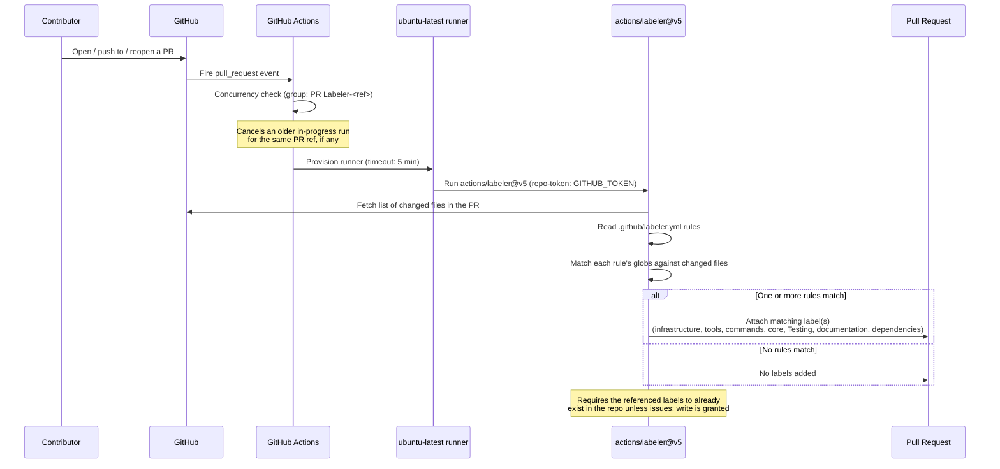
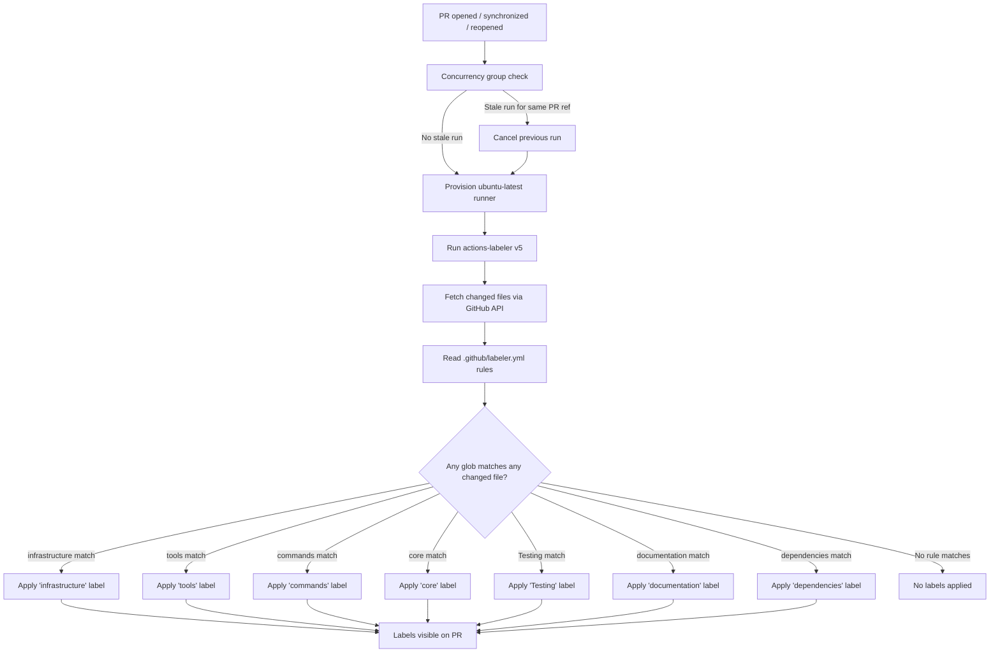

# PR Labeler — Automated Pull Request Labeling

> The PR Labeler automatically tags every pull request with area-of-change labels (`infrastructure`, `tools`, `commands`, `core`, `Testing`, `documentation`, `dependencies`) based on which files were touched — no manual labeling required.

## Table of Contents

- [Overview](#overview)
- [How it works](#how-it-works)
- [File locations — why they differ](#file-locations--why-they-differ)
- [Full lifecycle — step by step](#full-lifecycle--step-by-step)
- [Workflow: pr-labeler.yml](#workflow-pr-labeleryml)
  - [Triggers](#triggers)
  - [Concurrency](#concurrency)
  - [Permissions](#permissions)
  - [Job configuration](#job-configuration)
  - [Steps breakdown](#steps-breakdown)
- [Config: labeler.yml](#config-labeleryml)
  - [Label rules reference](#label-rules-reference)
- [Flow diagram](#flow-diagram)
- [Where results show up](#where-results-show-up)
- [Configuration reference](#configuration-reference)
- [Edge cases & safety](#edge-cases--safety)
- [What PR Labeler is NOT](#what-pr-labeler-is-not)
- [Recommended practices for CLIC](#recommended-practices-for-clic)
- [Future enhancements](#future-enhancements)

---

## Overview

Before this workflow existed, every PR had to be labeled by hand to signal which part of the codebase it touched — easy to forget, inconsistent between contributors, and useless for filtering issues/PRs at scale. The PR Labeler closes this gap using GitHub's official `actions/labeler` action: it reads the list of changed files in a PR, compares them against glob patterns defined in `.github/labeler.yml`, and automatically attaches matching labels.

This is purely organizational automation — it has no opinion on code quality, does not run tests, and cannot block a merge. It exists to make PRs scannable at a glance:

| Without PR Labeler | With PR Labeler |
|---|---|
| Reviewer opens the PR and reads the diff to figure out what area changed | Reviewer sees `tools` + `Testing` labels before opening the diff |
| Filtering "all open tooling PRs" requires manually combing through the PR list | `label:tools` in search instantly filters them |
| Labels are inconsistent across contributors (`test`, `tests`, `Testing`, `testing`) | Labels are deterministic — same glob, same label, every time |

---

## How it works

Two files work together:

```
.github/workflows/pr-labeler.yml   ← WHEN to run + WHO can modify labels (the workflow)
.github/labeler.yml                ← WHAT to label + based on WHICH files (the rules)
```

`pr-labeler.yml` is the GitHub Actions workflow — it defines the trigger (pull requests) and invokes `actions/labeler@v5`. `labeler.yml` is pure configuration, consumed by that action — it is not itself a workflow and does not run on its own. Every top-level key in `labeler.yml` is a **label name**; its value is a **match rule** describing which changed file globs should cause that label to be applied.

Neither file references the other by name anywhere in its own YAML — the link between them is implicit, created entirely by `actions/labeler@v5`'s own hardcoded default behavior of reading `.github/labeler.yml`.

---

## File locations — why they differ

The two files live in different folders, and this is a GitHub platform requirement, not a stylistic choice:

| File | Required location | Why |
|---|---|---|
| `pr-labeler.yml` | `.github/workflows/` | GitHub Actions **only** scans `.github/workflows/*.yml` to discover workflows. A file with `on:`/`jobs:` placed anywhere else is ignored and will never run. |
| `labeler.yml` | `.github/` (directly, not inside `workflows/`) | `actions/labeler@v5`'s own `configuration-path` input defaults to `.github/labeler.yml`. It is a plain data file, not a workflow — placing it inside `workflows/` would make GitHub try (and fail) to parse it as one. |

This mirrors the same pattern used elsewhere in `.github/`:

```
.github/
├── workflows/
│   ├── ci.yml              ← workflow (needs on:/jobs:)
│   ├── codeql.yml          ← workflow
│   └── pr-labeler.yml      ← workflow
├── dependabot.yml          ← config, NOT a workflow (Dependabot's hardcoded path)
├── labeler.yml             ← config, NOT a workflow (actions/labeler's hardcoded path)
└── CODEOWNERS              ← config, NOT a workflow (GitHub's hardcoded path)
```

**Rule of thumb:** anything that must be auto-discovered and *run* by GitHub Actions goes in `workflows/`. Anything that is *read as configuration* by a specific bot/action has its own fixed path dictated by that tool, almost always directly under `.github/`.

---

## Full lifecycle — step by step



---

## Workflow: pr-labeler.yml

### Triggers

```yaml
on:
  pull_request:
    types: [opened, synchronize, reopened]
```

| Event type | When it fires |
|---|---|
| `opened` | A new PR is created |
| `synchronize` | New commits are pushed to an existing PR's branch |
| `reopened` | A previously closed PR is reopened |

Re-running on `synchronize` matters because the file list can change as a PR evolves (e.g. a PR that started as `tools`-only later also touches `test/**` — it should pick up the `Testing` label too).

### Concurrency

```yaml
concurrency:
  group: ${{ github.workflow }}-${{ github.ref }}
  cancel-in-progress: true
```

Same pattern used across CLIC's other workflows (`ci.yml`, `codeql.yml`) — groups runs by workflow name + PR ref, cancelling a stale in-progress labeling run when a newer commit lands on the same PR. Prevents two concurrent runs from racing to add/remove labels.

### Permissions

```yaml
permissions:
  contents: read
  pull-requests: write
```

| Permission | Why it's needed |
|---|---|
| `contents: read` | Required to check the diff/changed-files list for the PR |
| `pull-requests: write` | Required to attach labels to the PR |

Note: this grants permission to apply **existing** labels only. Creating a brand-new label that doesn't yet exist in the repo additionally requires `issues: write` (see [Edge cases & safety](#edge-cases--safety)).

### Job configuration

```yaml
jobs:
  label:
    runs-on: ubuntu-latest
    timeout-minutes: 5
```

A single job named `label` runs on `ubuntu-latest`. `timeout-minutes: 5` is generous — this job does no checkout, build, or test; it is a single API-driven step that normally completes in seconds.

### Steps breakdown

```yaml
- uses: actions/labeler@v5
  with:
    repo-token: ${{ secrets.GITHUB_TOKEN }}
```
Runs GitHub's official labeler action. `repo-token` authorizes it to read the PR's changed-files list and write labels via the GitHub API. `secrets.GITHUB_TOKEN` is the automatically-provisioned, repo-scoped token — no manual secret setup required. There is no `actions/checkout` step because the action queries the GitHub API directly for the file list rather than needing a local clone.

---

## Config: labeler.yml

```yaml
infrastructure:
  - changed-files:
      - any-glob-to-any-file: '.github/**'

tools:
  - changed-files:
      - any-glob-to-any-file: 'src/tools/**'

commands:
  - changed-files:
      - any-glob-to-any-file: 'src/commands/**'

core:
  - changed-files:
      - any-glob-to-any-file:
          - 'src/agent.ts'
          - 'src/openai.ts'
          - 'src/memory.ts'
          - 'src/index.ts'

Testing:
  - changed-files:
      - any-glob-to-any-file: 'test/**'

documentation:
  - changed-files:
      - any-glob-to-any-file:
          - 'docs/**'
          - '*.md'
          - '.github/*.md'

dependencies:
  - changed-files:
      - any-glob-to-any-file:
          - 'package.json'
          - 'pnpm-lock.yaml'
```

Each top-level key is a label name. `any-glob-to-any-file` means: if **any** glob in the list matches **any** file changed in the PR, apply this label. A single PR can match multiple rules and receive multiple labels simultaneously.

### Label rules reference

| Label | Globs matched | Applies when a PR touches... |
|---|---|---|
| `infrastructure` | `.github/**` | Workflows, labeler config, issue templates, CODEOWNERS |
| `tools` | `src/tools/**` | Any tool module (`readFile.ts`, `runCommand.ts`, `terminal.ts`, etc.) |
| `commands` | `src/commands/**` | Any slash command module |
| `core` | `src/agent.ts`, `src/openai.ts`, `src/memory.ts`, `src/index.ts` | The ReAct loop, OpenAI client, memory store, or CLI entry point |
| `Testing` | `test/**` | Any test file |
| `documentation` | `docs/**`, `*.md`, `.github/*.md` | Docs, root markdown files (README, CLAUDE.md, AGENTS.md), or markdown inside `.github/` |
| `dependencies` | `package.json`, `pnpm-lock.yaml` | Dependency version bumps (including Dependabot PRs) |

Labels **must already exist** in the repository with these exact names (case-insensitive) for the action to successfully attach them, unless `issues: write` is granted (see below).

---

## Flow diagram



---

## Where results show up

| Location | What appears |
|---|---|
| PR sidebar ("Labels" section) | One or more matched labels (`tools`, `Testing`, etc.) |
| PR list view (`/pulls`) | Label badges next to the PR title |
| GitHub search / filters | `label:tools`, `label:dependencies`, etc. become usable filters |
| Action logs (`Actions` tab → `PR Labeler` run) | Which labels were added/removed, or an error if a label couldn't be created |

Labels applied this way behave exactly like manually-added labels — they can be removed by hand, and `actions/labeler` will not re-add a removed label unless the PR is updated again (`synchronize`) and the matching files are still part of the diff.

---

## Configuration reference

| Setting | Value | Source |
|---|---|---|
| Action version | `actions/labeler@v5` | `pr-labeler.yml` step |
| Trigger events | `opened`, `synchronize`, `reopened` | `pr-labeler.yml` `on.pull_request.types` |
| Runner | `ubuntu-latest` | `pr-labeler.yml` `jobs.label.runs-on` |
| Job timeout | 5 minutes | `pr-labeler.yml` `timeout-minutes` |
| Permissions | `contents: read`, `pull-requests: write` | `pr-labeler.yml` `permissions` |
| Rules file | `.github/labeler.yml` (default path, not overridden) | `actions/labeler` default `configuration-path` |
| Number of label rules | 7 | `labeler.yml` top-level keys |
| Match mode used | `any-glob-to-any-file` (OR logic) for every rule | `labeler.yml` |

---

## Edge cases & safety

**Label must already exist (most common failure)**
With only `pull-requests: write` granted, `actions/labeler` can **apply** a label but cannot **create** one that doesn't exist in the repo yet. If `labeler.yml` references a label name that has no matching repo label, that specific label is skipped or the step errors, depending on the action version. CLIC avoids this by ensuring all 7 label names (`infrastructure`, `tools`, `commands`, `core`, `Testing`, `documentation`, `dependencies`) already exist in the repository's label list.

**Case-insensitive label matching**
GitHub treats label names as case-insensitive for existence checks — `testing` and `Testing` are considered the same label. `labeler.yml` uses `Testing` (capitalized) to exactly match the repo's existing label casing, but this is cosmetic; functionally either case would have matched.

**Granting `issues: write` to auto-create missing labels**
If you want the action to create a label automatically the first time it's needed (instead of requiring manual pre-creation), add `issues: write` to the `permissions` block. CLIC currently does **not** do this — labels are pre-created manually, which is the safer, more explicit option recommended by `actions/labeler`'s own docs.

**`pull_request` vs `pull_request_target`**
This workflow uses `pull_request`, which runs with read-only permissions when the PR comes from a fork (limiting write access). This is intentional and safe — `pull_request_target` would grant broader permissions to forked PRs, which is a known security risk (`actions/labeler`'s docs explicitly warn about this). The trade-off is that labeling may fail silently for PRs opened from forks with `HttpError: Resource not accessible by integration` — acceptable for CLIC's current contribution model.

**No labels removed automatically**
By default (`sync-labels` not set, defaults to `false`), the labeler only **adds** matching labels — it never removes a label just because the matching files are no longer in the diff. A label stays on a PR once applied, even if later commits remove the files that triggered it.

**Concurrency and force-pushes**
Same as other CLIC workflows — a force-push keeps `github.ref` unchanged, so the newer labeling run correctly cancels a stale one instead of both running and potentially conflicting while writing labels.

---

## What PR Labeler is NOT

- It is **not** a security or quality gate — it cannot fail a PR or block merging
- It does **not** run tests, builds, or type checks — see `ci.yml` for that
- It does **not** create missing labels by default — requires either pre-created labels or explicit `issues: write` permission
- It does **not** remove labels when matching files are reverted (no `sync-labels: true` configured)
- It does **not** label based on PR title, description, or branch name — matching is purely changed-file-glob based in CLIC's current config (no `base-branch`/`head-branch` rules are defined)

---

## Recommended practices for CLIC

| Scenario | Recommended action |
|---|---|
| Adding a new top-level source folder (e.g. `src/plugins/`) | Add a corresponding rule to `labeler.yml` so PRs touching it get labeled automatically |
| Renaming a label in `labeler.yml` | Ensure a label with the exact new name already exists in the repo first (or grant `issues: write` temporarily) |
| A PR spans multiple areas (e.g. `tools` + `Testing`) | No action needed — multiple labels are applied automatically, this is expected behavior |
| Fork-based PR doesn't get labeled | Expected with `pull_request` (not `pull_request_target`) — label it manually; do not switch to `pull_request_target` without understanding the security trade-off |

---

## Future enhancements

| Enhancement | When to add |
|---|---|
| `sync-labels: true` | Once the team wants stale labels automatically removed when matching files are reverted |
| `base-branch` / `head-branch` rules | To auto-label PRs by branch naming convention (e.g. `feature/*` → `feature` label) |
| `changed-files-labels-limit` / `max-files-changed` | If large tree-wide refactor PRs start generating excessive or noisy labels |
| `issues: write` + auto-create | If new labels are introduced frequently and manual pre-creation becomes a bottleneck |
