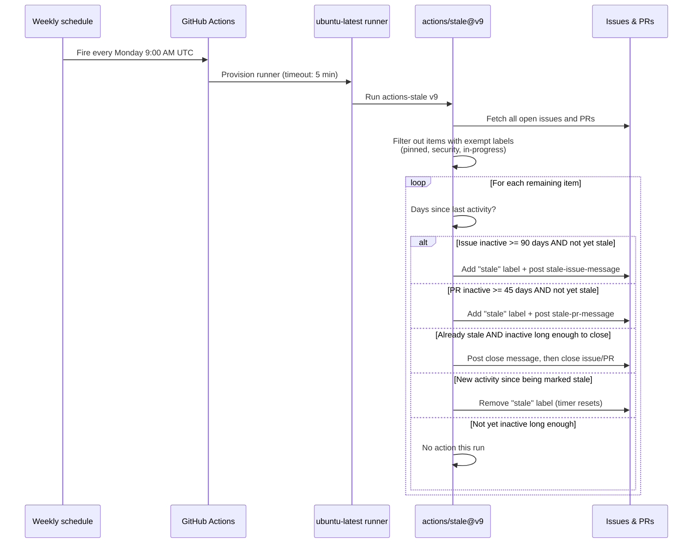
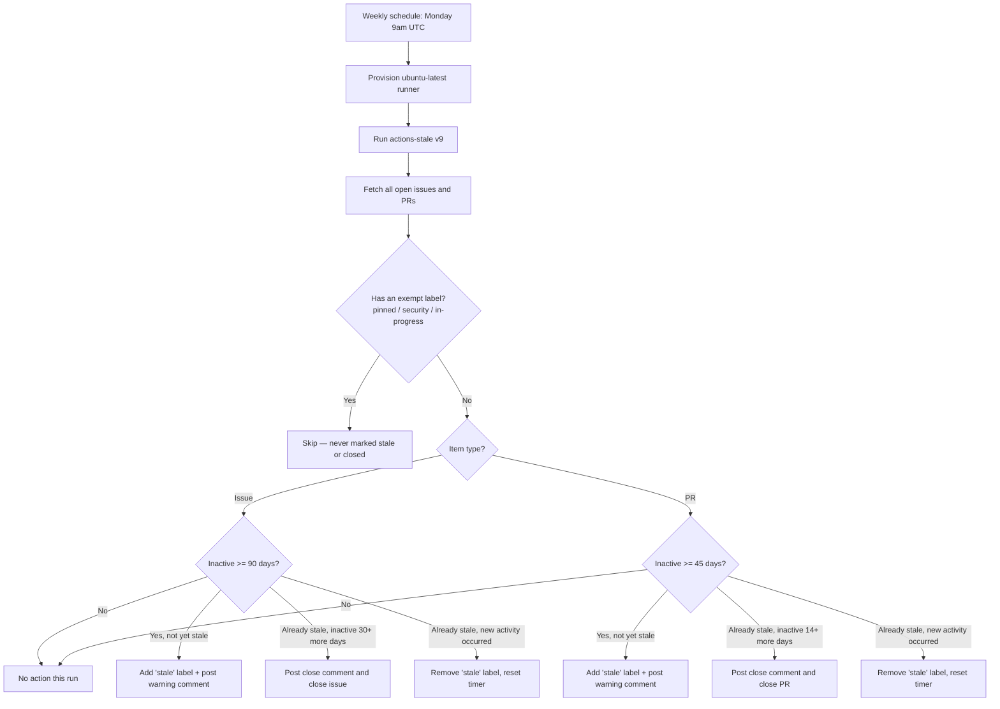

# Stale — Automated Issue & PR Lifecycle Management

> The Stale workflow automatically flags inactive issues and pull requests, warns with a comment, and closes them after a grace period — keeping the backlog signal-to-noise ratio high without manual triage.

## Table of Contents

- [Overview](#overview)
- [How it works](#how-it-works)
- [Full lifecycle — step by step](#full-lifecycle--step-by-step)
- [Workflow: stale.yml](#workflow-staleyml)
  - [Triggers](#triggers)
  - [Permissions](#permissions)
  - [Job configuration](#job-configuration)
  - [Steps breakdown](#steps-breakdown)
- [Issue vs PR timelines](#issue-vs-pr-timelines)
- [Flow diagram](#flow-diagram)
- [Where results show up](#where-results-show-up)
- [Configuration reference](#configuration-reference)
- [Edge cases & safety](#edge-cases--safety)
- [What Stale is NOT](#what-stale-is-not)
- [Recommended practices for CLIC](#recommended-practices-for-clic)
- [Future enhancements](#future-enhancements)

---

## Overview

Without this workflow, abandoned issues and stalled PRs accumulate indefinitely — making it hard to tell what's actually actionable versus what was opened once and forgotten. The Stale workflow uses GitHub's official `actions/stale` action to run a weekly sweep: anything inactive long enough gets a warning comment and a `stale` label; anything that stays inactive after that gets auto-closed with an explanatory comment.

| Without Stale | With Stale |
|---|---|
| Old issues/PRs sit open forever, burying active work | Inactive items are automatically flagged and eventually closed |
| Maintainers manually comb through the backlog to find dead items | The weekly sweep does this for them |
| No consistent inactivity policy across contributors | Same 90/30-day (issues) and 45/14-day (PRs) policy applied uniformly |
| Important long-running work risks being auto-closed | Protected via `exempt-issue-labels` / `exempt-pr-labels` |

---

## How it works

Unlike `pr-labeler.yml` (which pairs with a separate `labeler.yml` config file), `stale.yml` is **fully self-contained** — all of its behavior is configured inline via the `with:` block passed to `actions/stale@v9`. There is no companion config file.

```
Phase 1 — Scan (weekly, scheduled)
    │
    ├── Fetch all open issues and all open pull requests
    ├── For each item, check: has it had any activity in N days?
    └── Skip anything carrying an exempt label

Phase 2 — Mark stale
    │
    ├── If inactive ≥ days-before-issue-stale (issues) or days-before-pr-stale (PRs)
    ├── Add a "stale" label
    └── Post the configured warning comment

Phase 3 — Close
    │
    ├── If still inactive ≥ days-before-issue-close / days-before-pr-close AFTER being marked stale
    ├── Post the configured closing comment
    └── Close the issue/PR

Phase 4 — Un-stale (implicit)
    │
    └── Any new comment or commit on a "stale"-labeled item removes the label and resets its timer
```

---

## Full lifecycle — step by step



---

## Workflow: stale.yml

### Triggers

```yaml
on:
  schedule:
    - cron: '0 9 * * 1'   # Every Monday 9am UTC
```

Purely time-based — unlike `ci.yml`, `codeql.yml`, or `pr-labeler.yml`, there is no `push`/`pull_request` trigger. It fires once a week (every Monday, 9:00 AM UTC) regardless of repository activity. GitHub Actions cron schedules are always evaluated in UTC, no matter what the comment says — hence the explicit `UTC` note.

### Permissions

```yaml
permissions:
  issues: write
  pull-requests: write
```

| Permission | Why it's needed |
|---|---|
| `issues: write` | Required to add the `stale` label, post comments, and close issues |
| `pull-requests: write` | Required to do the same for pull requests |

No `contents` permission is requested at all — this workflow never touches repository code or checks anything out.

### Job configuration

```yaml
jobs:
  stale:
    runs-on: ubuntu-latest
    timeout-minutes: 5
```

A single job named `stale` runs on `ubuntu-latest`. `timeout-minutes: 5` is generous — this is a single API-driven step with no build or test overhead; actual runtime scales with the number of open issues/PRs but is normally well under a minute for most repos.

### Steps breakdown

```yaml
- uses: actions/stale@v9
  with:
    stale-issue-message: >
      This issue has been inactive for 90 days. It will be closed in 30 days
      unless there is new activity. Comment to keep it open.
    stale-pr-message: >
      This PR has been inactive for 45 days. It will be closed in 14 days
      unless there is new activity. Push a commit or comment to keep it open.
    close-issue-message: 'Closing due to inactivity. Reopen if still relevant.'
    close-pr-message: 'Closing due to inactivity. Reopen and push a new commit to resume.'
    days-before-issue-stale: 90
    days-before-issue-close: 30
    days-before-pr-stale: 45
    days-before-pr-close: 14
    exempt-issue-labels: 'pinned,security,in-progress'
    exempt-pr-labels: 'pinned,security,in-progress'
```

Runs GitHub's official stale-bot action with no custom `repo-token` input — it falls back to the default `github.token`, which is sufficient given the permissions already granted above. Every other input is a behavioral override of the action's own defaults (see [Configuration reference](#configuration-reference)).

---

## Issue vs PR timelines

`actions/stale@v9` supports fully independent thresholds for issues and pull requests — CLIC uses this to give issues a much longer grace period than PRs, since stale PRs tend to represent abandoned work-in-progress branches that are safe to close sooner, while issues may describe long-standing bugs or ideas worth preserving longer.

| | Issues | Pull Requests |
|---|---|---|
| Days inactive → marked stale | `days-before-issue-stale: 90` | `days-before-pr-stale: 45` |
| Days stale → auto-closed | `days-before-issue-close: 30` | `days-before-pr-close: 14` |
| Total inactivity before closure | 120 days | 59 days |
| Warning message | `stale-issue-message` | `stale-pr-message` |
| Closing message | `close-issue-message` | `close-pr-message` |
| Exempt labels | `pinned`, `security`, `in-progress` | `pinned`, `security`, `in-progress` |

```
Issue timeline:  day 0 ───────── 90 days ─────────▶ [stale] ──── 30 days ────▶ [closed]
PR timeline:     day 0 ──── 45 days ────▶ [stale] ── 14 days ──▶ [closed]
```

---

## Flow diagram



---

## Where results show up

| Location | What appears |
|---|---|
| Issue/PR timeline | A bot comment with the configured `stale-*-message` or `close-*-message` text |
| Issue/PR labels | A `stale` label is added when flagged, removed automatically if activity resumes |
| Issue/PR state | Changes from `open` to `closed` once the close threshold is reached |
| Action logs (`Actions` tab → `Stale` run) | Summary of how many issues/PRs were marked stale, closed, or skipped that run |

Closed items can always be manually reopened — closure by this workflow is not permanent or special in any way; it behaves identically to a human closing the issue/PR.

---

## Configuration reference

| Setting | Value | Source |
|---|---|---|
| Action version | `actions/stale@v9` | `stale.yml` step |
| Trigger | Weekly, Monday 9:00 AM UTC | `stale.yml` `on.schedule` cron |
| Runner | `ubuntu-latest` | `stale.yml` `jobs.stale.runs-on` |
| Job timeout | 5 minutes | `stale.yml` `timeout-minutes` |
| Permissions | `issues: write`, `pull-requests: write` | `stale.yml` `permissions` |
| Issue stale threshold | 90 days | `days-before-issue-stale` |
| Issue close threshold | 30 days after stale | `days-before-issue-close` |
| PR stale threshold | 45 days | `days-before-pr-stale` |
| PR close threshold | 14 days after stale | `days-before-pr-close` |
| Exempt labels (issues) | `pinned`, `security`, `in-progress` | `exempt-issue-labels` |
| Exempt labels (PRs) | `pinned`, `security`, `in-progress` | `exempt-pr-labels` |
| Companion config file | None — fully inline in `stale.yml` | N/A |

---

## Edge cases & safety

**Exempt labels are the only protection against auto-closure**
Anything labeled `pinned`, `security`, or `in-progress` is permanently skipped by this workflow, regardless of how long it's been inactive. If a label is removed later, the item becomes eligible for staleness on the next weekly run (using its actual last-activity date, not the date the label was removed).

**Separate issue/PR thresholds are independent — easy to desync accidentally**
Because `days-before-issue-*` and `days-before-pr-*` are configured separately, editing one without the other can silently create a mismatch between the configured numbers and the hardcoded wording inside `stale-issue-message` / `stale-pr-message` (which are plain text, not templated). Always update the message text alongside the day-count inputs.

**No `contents` permission — cannot touch code**
This workflow can only write to issues and PRs via their respective APIs — it never checks out the repository and cannot modify source files, regardless of what happens to an issue/PR.

**Reopening resets the clock**
If a closed issue/PR is manually reopened, its "last activity" timestamp updates, so it effectively restarts at day 0 for staleness purposes on the next scheduled run.

**Weekly granularity, not real-time**
Because this only runs once a week via `schedule`, an item crossing a staleness threshold won't be flagged until the *next* Monday 9:00 AM UTC run — not the instant it technically becomes stale. This is a deliberate trade-off to avoid running the check more frequently than needed.

**Default `repo-token` is sufficient**
Unlike `pr-labeler.yml`, this workflow does not explicitly pass `repo-token: ${{ secrets.GITHUB_TOKEN }}` — `actions/stale@v9` defaults to `github.token` automatically, so the omission is intentional and not a misconfiguration.

---

## What Stale is NOT

- It is **not** a security or CI gate — it never blocks merges, builds, or releases
- It does **not** touch repository code, run tests, or do anything requiring `contents` permission
- It does **not** run on `push` or `pull_request` events — purely scheduled, weekly
- It does **not** permanently delete anything — closing is reversible by reopening
- It does **not** need a separate config file like `labeler.yml` — all behavior lives inline in `stale.yml`

---

## Recommended practices for CLIC

| Scenario | Recommended action |
|---|---|
| A long-running issue/PR you want to keep open indefinitely | Add the `pinned`, `security`, or `in-progress` label |
| Adjusting day thresholds | Update both the `days-before-*` input **and** the matching wording in `stale-issue-message`/`stale-pr-message` together |
| Want faster PR cleanup (e.g. draft PRs going stale) | Lower `days-before-pr-stale` / `days-before-pr-close` — keep issue thresholds longer since issues capture longer-lived discussions |
| Noticing valid items getting auto-closed | Check if they're missing an exempt label before increasing thresholds repo-wide |

---

## Future enhancements

| Enhancement | When to add |
|---|---|
| `exempt-issue-milestones` / `exempt-pr-milestones` | To protect items tied to an active release milestone regardless of labels |
| `stale-issue-label` / `stale-pr-label` custom names | If `"stale"` should be renamed for clarity (e.g. `needs-attention`) |
| `only-labels` input | To restrict the stale sweep to specific categories only (e.g. only `question`-labeled issues) |
| Daily or bi-weekly schedule | If weekly granularity proves too coarse for a faster-moving backlog |
