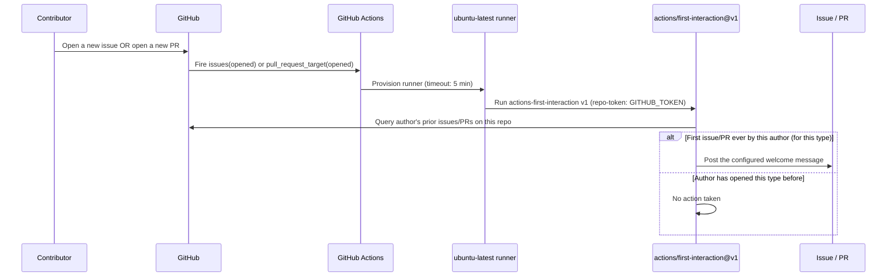
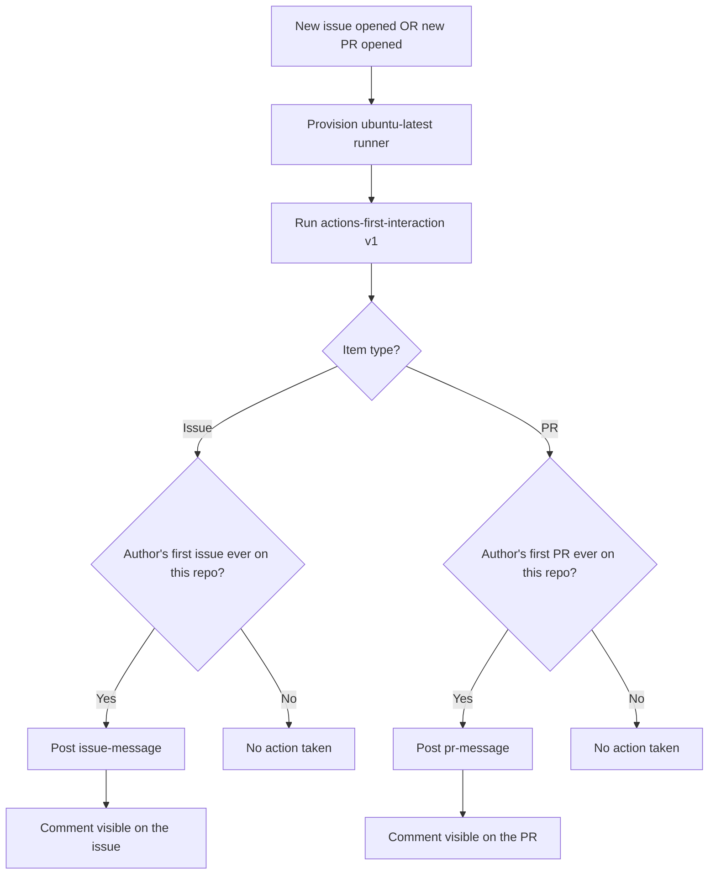

# Welcome — First-Interaction Greeting Bot

> The Welcome workflow automatically posts a friendly onboarding comment the very first time a contributor opens an issue or a pull request on CLIC — a one-time greeting, never repeated for the same person.

## Table of Contents

- [Overview](#overview)
- [How it works](#how-it-works)
- [Full lifecycle — step by step](#full-lifecycle--step-by-step)
- [Workflow: welcome.yml](#workflow-welcomeyml)
  - [Triggers](#triggers)
  - [Permissions](#permissions)
  - [Job configuration](#job-configuration)
  - [Steps breakdown](#steps-breakdown)
- [Messages reference](#messages-reference)
- [Flow diagram](#flow-diagram)
- [Where results show up](#where-results-show-up)
- [Configuration reference](#configuration-reference)
- [Edge cases & safety](#edge-cases--safety)
- [What Welcome is NOT](#what-welcome-is-not)
- [Recommended practices for CLIC](#recommended-practices-for-clic)
- [Future enhancements](#future-enhancements)

---

## Overview

Without this workflow, a first-time contributor's issue or PR looks exactly like anyone else's — no acknowledgement, no pointer to `CONTRIBUTING.md`, no sense that a human will actually look at it. The Welcome workflow uses GitHub's official `actions/first-interaction` action to detect "is this the author's first-ever issue?" or "is this their first-ever PR?" and, if so, posts a tailored comment.

| Without Welcome | With Welcome |
|---|---|
| First-time contributors get silence after submitting | They immediately get an acknowledgement + guidance |
| No consistent pointer to `CONTRIBUTING.md` or templates | Every first-timer is linked to it automatically |
| Maintainers manually write "thanks, please check X" on every new contributor's first item | Fully automated, zero maintainer effort |
| Repeat contributors would get a redundant greeting if automated naively | `first-interaction` tracks history — greets each person exactly once per type (issue/PR) |

---

## How it works

Like `stale.yml`, this workflow is **fully self-contained** — all behavior is configured inline via the `with:` block, no companion config file is involved.

```
On every new issue or PR:
    │
    ├── actions/first-interaction@v1 queries the GitHub API
    │     for the author's issue/PR history on this repo
    │
    ├── Is this their first issue ever on this repo?
    │     └── Yes → post `issue-message`
    │     └── No  → do nothing
    │
    └── Is this their first PR ever on this repo?
          └── Yes → post `pr-message`
          └── No  → do nothing
```

Issues and PRs are tracked **independently** — a contributor's first issue and first PR each trigger their own one-time message, even if they've already interacted with the repo in the other form.

---

## Full lifecycle — step by step



---

## Workflow: welcome.yml

### Triggers

```yaml
on:
  pull_request_target:
    types: [opened]
  issues:
    types: [opened]
```

| Trigger | When it fires |
|---|---|
| `issues.opened` | Any new issue is created, by anyone |
| `pull_request_target.opened` | Any new PR is opened, by anyone — including forked PRs |

**Why `pull_request_target` instead of `pull_request`:** this workflow needs write access (to post a comment) even when the PR comes from a fork. `pull_request` would run with read-only permissions for forked PRs and fail to comment; `pull_request_target` runs with the base repository's permissions regardless of where the PR originates. This is the same trade-off `actions/labeler`'s own docs recommend for write-requiring actions on forked PRs (see [pr-labeler.md](pr-labeler.md#edge-cases--safety)).

**Why this is safe here:** `pull_request_target` is risky only when a workflow checks out and *executes* code from the untrusted fork. This workflow never runs `actions/checkout` and never executes anything from the PR branch — it only reads PR *metadata* (the author's history) and posts a comment. There is no code-execution surface for a malicious fork to exploit.

### Permissions

```yaml
permissions:
  issues: write
  pull-requests: write
```

| Permission | Why it's needed |
|---|---|
| `issues: write` | Required to post the welcome comment on a new issue |
| `pull-requests: write` | Required to post the welcome comment on a new PR |

No `contents` permission is requested — this workflow never checks out or reads repository source files.

### Job configuration

```yaml
jobs:
  welcome:
    runs-on: ubuntu-latest
    timeout-minutes: 5
```

A single job named `welcome` runs on `ubuntu-latest`. `timeout-minutes: 5` comfortably covers the single API call this job makes — there is no build, test, or checkout step.

### Steps breakdown

```yaml
- uses: actions/first-interaction@v1
  with:
    repo-token: ${{ secrets.GITHUB_TOKEN }}
    issue-message: |
      ...
    pr-message: |
      ...
```

Runs GitHub's official first-interaction action. `repo-token` is explicitly passed (unlike `stale.yml`, which relies on the default) so the action can query the author's contribution history and write the comment. `issue-message` and `pr-message` are the exact Markdown bodies posted — see [Messages reference](#messages-reference) below.

---

## Messages reference

### `issue-message` (posted on a contributor's first-ever issue)

```markdown
## 👋 Welcome to CLIC!

Thanks for opening your **first issue** — we're glad you're here!

Before we take a look, please double-check:

- ✅ You've read [CONTRIBUTING.md](./CONTRIBUTING.md)
- ✅ The issue template is filled out completely
- ✅ You've searched existing issues to avoid duplicates

A maintainer will get back to you as soon as possible. 🚀

---
*This is an automated message — thanks for contributing to CLIC!*
```

### `pr-message` (posted on a contributor's first-ever PR)

```markdown
## 🎉 Thanks for your first contribution to CLIC!

We really appreciate you taking the time to submit this pull request.

Before requesting a review, please make sure:

- ✅ All CI checks pass (`typecheck`, `build`, full test suite)
- ✅ The PR template is filled out completely
- ✅ Your changes include tests where applicable

📖 See [CONTRIBUTING.md](./CONTRIBUTING.md) for our full contribution guidelines.

---
*This is an automated message — a maintainer will review your PR shortly!* ⭐
```

Both messages use a Markdown header, a bolded callout, a checklist of pre-flight items, and a dimmed italic footer clarifying the comment is automated — intentionally more visually structured than the plain-text messages used in `stale.yml`, since this is the contributor's very first impression of the project.

---

## Flow diagram



---

## Where results show up

| Location | What appears |
|---|---|
| Issue timeline (first-time issue authors only) | The `issue-message` Markdown comment |
| PR timeline (first-time PR authors only) | The `pr-message` Markdown comment |
| Action logs (`Actions` tab → `Welcome` run) | Whether a comment was posted or skipped (not a first interaction) |

Nothing changes for repeat contributors — no comment, no label, no visible trace that the workflow even ran on their item.

---

## Configuration reference

| Setting | Value | Source |
|---|---|---|
| Action version | `actions/first-interaction@v1` | `welcome.yml` step |
| Issue trigger | `issues.opened` | `welcome.yml` `on.issues.types` |
| PR trigger | `pull_request_target.opened` | `welcome.yml` `on.pull_request_target.types` |
| Runner | `ubuntu-latest` | `welcome.yml` `jobs.welcome.runs-on` |
| Job timeout | 5 minutes | `welcome.yml` `timeout-minutes` |
| Permissions | `issues: write`, `pull-requests: write` | `welcome.yml` `permissions` |
| Companion config file | None — fully inline in `welcome.yml` | N/A |
| Repeats per contributor | Once per type (issue, PR) — never again after the first | `actions/first-interaction` built-in behavior |

---

## Edge cases & safety

**`pull_request_target` security consideration**
This event type grants elevated permissions to workflows triggered by forked PRs — a known risk if the workflow executes untrusted code. This workflow mitigates that risk by never running `actions/checkout` or executing anything from the PR branch; it only reads metadata and posts a comment, which is the same safe usage pattern GitHub documents for `actions/first-interaction` and `actions/labeler`.

**"First interaction" is tracked per type, not globally**
A contributor who has opened issues for months but never a PR will still receive the `pr-message` the first time they open one — this is expected, not a bug. The action checks issue-history and PR-history as two separate counters.

**Message text is static Markdown, not dynamically templated**
Unlike `stale.yml`'s messages (which hardcode day-counts that must match the `days-before-*` inputs), `welcome.yml`'s messages don't reference any other config values, so there's no drift risk here — the messages are safe to edit freely without touching other inputs.

**No `contents` permission — cannot read or modify code**
This workflow has no ability to inspect the diff, read files, or interact with anything beyond issue/PR metadata and comments.

**Runs on every single new issue/PR, not just from forks**
Even maintainers' own new issues/PRs pass through this workflow — the first-interaction check simply resolves to "no" after their very first contribution, so no comment appears for them after that point.

---

## What Welcome is NOT

- It is **not** a CI or security gate — it cannot fail, block, or review anything
- It does **not** label issues/PRs — compare with `pr-labeler.yml`, which does file-based labeling
- It does **not** check out or execute any code from the triggering PR, despite using `pull_request_target`
- It does **not** repeat — once a contributor has one issue and one PR under their belt, they never see this message again
- It does **not** require a companion config file — everything is inline, unlike `labeler.yml`'s relationship to `pr-labeler.yml`

---

## Recommended practices for CLIC

| Scenario | Recommended action |
|---|---|
| Updating contribution guidelines | Keep the `CONTRIBUTING.md` link in both messages in sync with any file renames/moves |
| Wanting a different tone/branding | Edit `issue-message` / `pr-message` directly — no other config depends on this text |
| Testing message changes before contributors see them | Open a throwaway issue/PR from a test account that has never interacted with the repo before — a repeat account won't trigger the bot |
| Combining with `pr-labeler.yml` | No conflict — both can fire on the same PR open event independently (one labels, one comments) |

---

## Future enhancements

| Enhancement | When to add |
|---|---|
| Add a "first-interaction" label alongside the comment | If maintainers want to filter/triage first-time contributions visually, similar to `pr-labeler.yml`'s approach |
| Link directly to good-first-issue labeled items in `issue-message` | To help first-time issue reporters discover existing easy tasks |
| Add a Discord/Slack mention for new contributors | Once the project has an external community channel worth notifying |
| Localize messages | If CLIC gains non-English-speaking contributors at scale |
